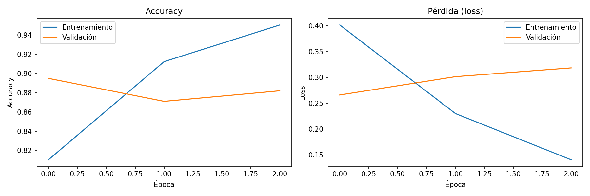
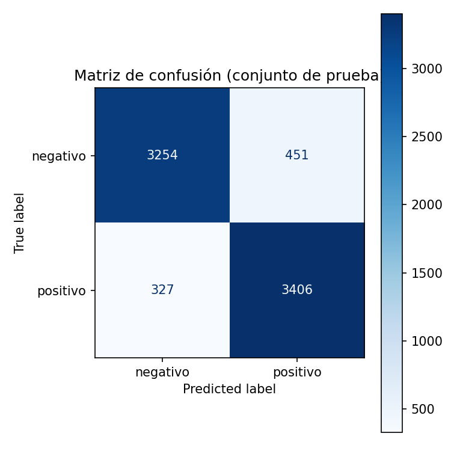

# 🎬 Análisis de sentimiento con redes recurrentes (LSTM / GRU)

Proyecto de Deep Learning con **datos secuenciales (texto)**: una red recurrente bidireccional clasifica reseñas de películas como positivas o negativas. Se comparan LSTM y GRU, y el mejor modelo se usa desde una app Streamlit.

## Dataset
**IMDB Large Movie Review Dataset** (Stanford): 50.000 reseñas en inglés, balanceadas (25.000 positivas / 25.000 negativas). Se descarga automáticamente desde `ai.stanford.edu` (no se versiona en Git).

## Estructura del repositorio
```
├── notebooks/experimentacion.ipynb   # Experimentación completa (Colab): EDA, limpieza, división,
│                                     # LSTM vs GRU, métricas, gráficas, 12 predicciones
├── src/
│   ├── data.py        # descarga, carga, limpieza, división 70/15/15
│   ├── model.py       # TextVectorization + Embedding + RNN bidireccional
│   ├── train.py       # entrenamiento y evaluación por línea de comandos
│   ├── evaluate.py    # métricas, gráficas, matriz de confusión, tabla de predicciones
│   └── predict.py     # carga del modelo y predicción (módulo + CLI)
├── app/streamlit_app.py              # aplicación web
├── models/sentimiento_rnn.keras      # modelo entrenado (incluye el vectorizador)
├── reports/                          # curvas, matriz de confusión, ROC, métricas, predicciones
└── requirements.txt
```

## Metodología
1. **EDA:** balance de clases, distribución de longitudes, palabras más frecuentes, duplicados y ejemplos.
2. **Limpieza:** eliminación de duplicados (antes de dividir, para evitar fuga de datos), de etiquetas HTML y URLs.
3. **Preprocesamiento:** `TextVectorization` (vocabulario de 20.000 palabras, secuencias de 300 tokens) dentro del modelo.
4. **División:** 70 % entrenamiento / 15 % validación / 15 % prueba, estratificada.
5. **Modelo:** `Embedding(64) → Bidirectional(LSTM|GRU, 64) → Dropout → Dense(64) → Dropout → Sigmoide`.
6. **Entrenamiento:** Adam, `EarlyStopping` sobre `val_loss`. Se comparan LSTM y GRU y se guarda la mejor.
7. **Evaluación:** accuracy, precision, recall, F1, ROC-AUC, matriz de confusión y curva ROC en prueba.

## Resultados
> Completa tras entrenar (datos en `reports/metrics.json` y `reports/comparacion_modelos.csv`).

| Métrica (test) | Valor |
|---|---|
| Modelo ganador | LSTM |
| Accuracy | 89.5% |
| F1 | 0.8974 |
| ROC-AUC | 0.9581 |




## Ejecución

**Requiere Python 3.10 o superior** (probado con 3.12 y TensorFlow 2.21). En Windows con varias versiones instaladas usa el lanzador `py -3.12`.

### 1. Instalación
```bash
git clone https://github.com/SantiagoPerdomo25/rnn-sentimiento
cd rnn-sentimiento
py -3.12 -m venv .venv          # Mac/Linux: python3.12 -m venv .venv
.venv\Scripts\activate          # Mac/Linux: source .venv/bin/activate
pip install -r requirements.txt
```

### 2. Entrenar (opción A: línea de comandos)
```bash
python -m src.train --cell lstm --epochs 8     # o --cell gru
```

### 2. Entrenar (opción B: Google Colab)
1. Abre `notebooks/experimentacion.ipynb` en Colab (*Archivo → Abrir cuaderno → GitHub*) y activa la GPU.
2. Ejecuta todas las celdas; la última descarga `artefactos.zip` (modelo + reportes).
3. Descomprímelo en la raíz del repositorio y haz commit y push. Guarda también el notebook ejecutado (*Archivo → Descargar → .ipynb*).

### 3. Predicción por consola
```bash
python -m src.predict "An absolutely wonderful movie, I loved it"
```

### 4. Aplicación Streamlit
```bash
streamlit run app/streamlit_app.py
```
Abre `http://localhost:8501`, escribe una reseña en inglés y verás el sentimiento, la confianza y la probabilidad.

## Limitaciones
- Solo funciona con texto **en inglés** (vocabulario de IMDB).
- Puede fallar con sarcasmo, ironía o reseñas mixtas; la app avisa cuando la confianza es baja.
- Las reseñas largas se recortan a 300 palabras.
- Mejoras posibles: embeddings preentrenados (GloVe), atención o Transformers.
